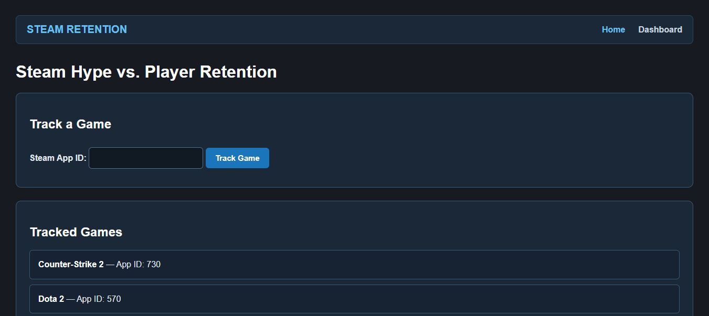
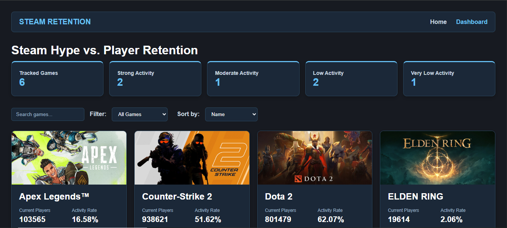
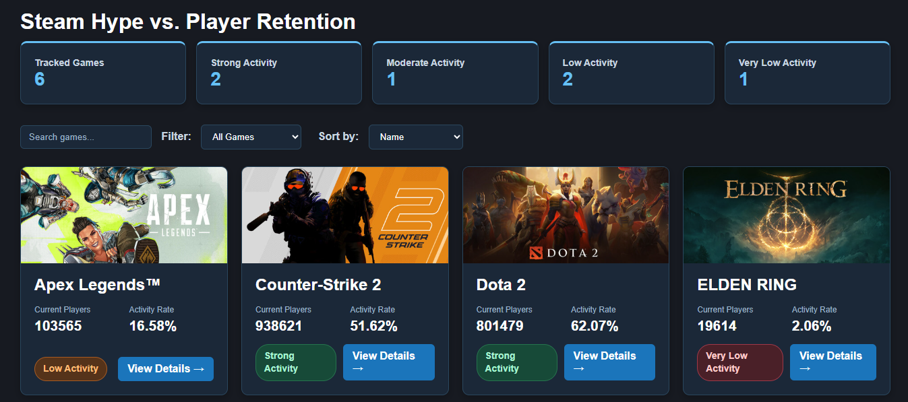
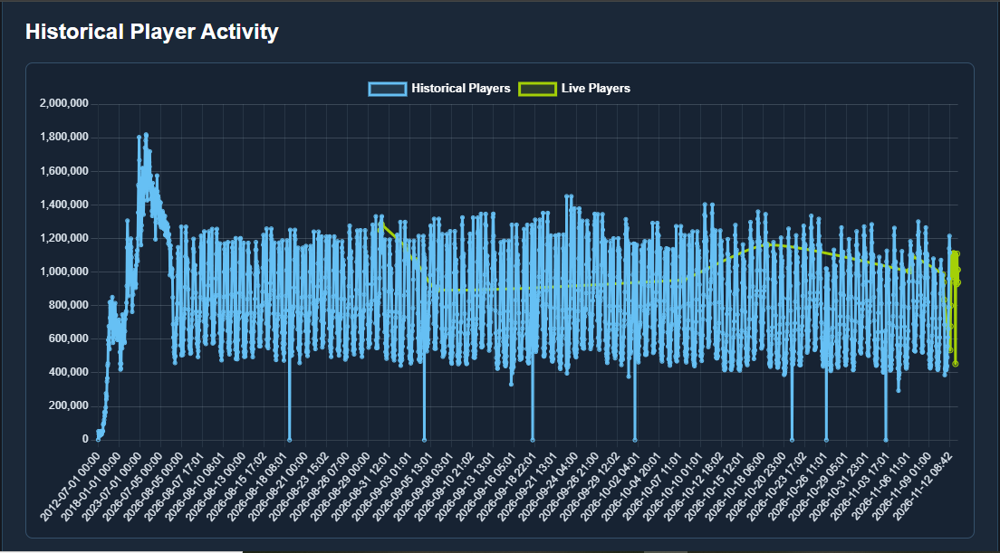

# 🎮 Steam Hype vs. Player Retention Engine

### Analyzing the long-term popularity and player retention of Steam games.

Steam Hype vs. Player Retention Engine is a Django-based analytics application designed to examine how video games retain their player bases after launch.

The platform collects live concurrent player counts, imports historical player data, and analyzes changes in player activity over time.

Rather than looking only at a game's launch popularity, the project focuses on a more interesting question:

**Does a game maintain its player base after the initial launch hype fades?**

---

## 📸 Application Screenshots

### 1. Home Page

The landing page introduces Steam Retention and its purpose.

### 2. Games Dashboard

The main dashboard displays tracked games, including CS2, Apex Legends, Dota 2, ELDEN RING, GTA V, and PUBG.

### 3. Dashboard Analytics

An additional dashboard view showcasing game activity and retention information.

### 4. Individual Game Statistics

The game details page provides historical player-count charts and individual game analysis.

---

## ✨ Key Features

- **Live Player Tracking:** Collects current concurrent player counts using the Steam Web API.
- **Historical Data Import:** Imports historical player-count data from SteamCharts.
- **Player Snapshots:** Stores collected player counts over time for historical analysis.
- **Historical Peak Analysis:** Compares current activity against a game's historical player peak.
- **Retention Analysis:** Examines current player activity relative to historical peaks.
- **Trend Analysis:** Calculates player-count changes over 7-day and 30-day periods.
- **Game Classification:** Categorizes games according to their activity levels and player trends.
- **Interactive Charts:** Uses Chart.js to visualize historical player activity.
- **Automated Collection:** Supports scheduled player-count collection through Windows Task Scheduler.
- **Game Management:** Supports adding and tracking Steam games using their application IDs.

---

## 🛠️ Technology Stack

| Technology | Purpose |
|---|---|
| Python | Application logic and data analysis |
| Django | Backend web framework |
| SQLite | Database and player snapshots |
| Chart.js | Historical data visualization |
| Steam Web API | Live concurrent player counts |
| SteamCharts | Historical player-count data |
| HTML & CSS | User interface |
| JavaScript | Interactive frontend functionality |

---

## ⚙️ How It Works

The application follows a data collection and analysis workflow:

1. **Game Registration:** Games are added using their Steam application IDs.
2. **Historical Import:** Historical player-count records are imported.
3. **Live Collection:** Current concurrent player counts are collected from Steam.
4. **Snapshot Storage:** Player counts are stored with timestamps.
5. **Metric Calculation:** The application calculates activity levels and player-count trends.
6. **Visualization:** Results are presented through dashboards and individual game charts.

---

## 🏗️ Project Architecture

The application is organized into several components that handle data collection, storage, analysis, and visualization.

### 1. Data Collection Layer

- **Steam Web API:** Retrieves current concurrent player counts.
- **SteamCharts:** Supplies historical player-count data.
- **Automated Collection:** A management command collects live player data periodically.

### 2. Data Storage Layer

- **Game Model:** Stores game information, historical peaks, and calculated activity metrics.
- **PlayerSnapshot Model:** Stores player counts with timestamps and identifies whether records come from live or historical data.
- **SQLite:** Stores the application's game records and player snapshots.

### 3. Analysis Layer

The analysis services process collected player data to calculate:

- Historical player peaks.
- Current activity percentages.
- Seven-day and thirty-day player-count changes.
- Activity and trend classifications.
- Overall retention assessments.

### 4. Presentation Layer

- **Django Views:** Retrieve game information and analysis results.
- **Django Templates:** Render the home page, dashboard, and individual game pages.
- **Chart.js:** Visualizes historical player activity through interactive charts.

### 5. Automation Layer

Windows Task Scheduler can execute the `collect_players.bat` script at scheduled intervals, allowing the application to collect updated player counts automatically.

## 📊 Retention Analysis Methodology

The engine evaluates game activity using historical player data and current concurrent player counts.

### 1. Activity Analysis

The application compares a game's latest live player count against its historical player peak.

**Activity Percentage = (Current Players / Historical Peak) × 100**

This helps show how much activity a game currently retains relative to its highest recorded player count.

### 2. Player Trend Analysis

The application examines changes in player counts over two periods:

- **7-day change:** Shows recent player activity movement.
- **30-day change:** Provides a longer-term view of player activity.

These comparisons help identify whether a game is gaining players, remaining relatively stable, or experiencing a decline.

### 3. Activity Classification

Games are categorized according to their activity levels:

- Strong Activity
- Moderate Activity
- Low Activity
- Very Low Activity

This makes it easier to compare games with different player populations.

### 4. Overall Retention Assessment

The engine combines activity levels and player momentum to produce an overall assessment.

The analysis uses the following weighting:

- Activity Level: 70%
- Player Momentum: 30%

This gives current player activity greater importance while still considering recent player-count trends.

### 5. Historical Visualization

Historical player snapshots are displayed through interactive charts.

These visualizations help examine player-count movements over time and understand how a game's activity has changed since tracking began.

## 🎯 Project Objective

The main objective is to explore the relationship between launch popularity and long-term player retention.

The project aims to distinguish games that maintain sustained player activity from those experiencing significant declines after launch.

It provides a way to examine player activity using historical data rather than relying solely on launch-day popularity.

---

## 🔒 Source Code

This repository is a **public portfolio showcase**.

The complete application source code is maintained in a separate private GitHub repository and is not included here.

The screenshots and descriptions demonstrate the application's functionality and development work.

---

## 📌 Project Status

The application has a working Django backend, historical data import, automated player collection, retention analysis, and interactive game dashboards.

This project is independently developed and is not affiliated with, endorsed by, or sponsored by Valve Corporation or Steam.

